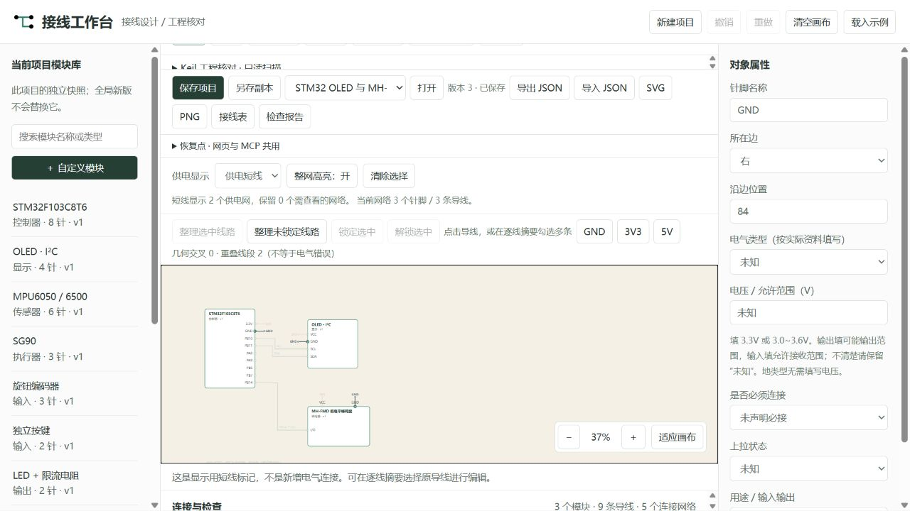

# 模块接线工作台 · Wiring Workbench

**把 STM32 模块接线整理成看得懂、能检查、可分享的图。**

面向 STM32 学习者、电子爱好者和教学演示：放入模块、连接引脚、高亮整条网络，导出接线图与接线表；还可以只读核对 Keil 工程中的引脚证据。Windows 本地运行，首次体验无需开发板、Keil 或 AI 账号。

[开始体验](#启动) · [第一次画图](docs/FIRST_RUN.md) · [桌面套装](docs/SUITE.md) · [反馈问题](https://github.com/9595846/wiring-workbench/issues/new/choose)



*编辑器截图：供电短线让图面更清楚，整网高亮帮助追踪 GND 的连接。图纸表示模块连接关系，不是面包板孔位图，不执行电路仿真。*

## 先选适合你的入口

| 你想做什么 | 从这里开始 |
| --- | --- |
| 第一次试用，先画一张接线图 | 按下方启动步骤运行，再完成[示例操作](docs/FIRST_RUN.md) |
| 接线和 OLED 界面一起设计 | 本仓库是套装主仓库，见[套装构建与使用](docs/SUITE.md) |
| 只使用独立 OLED 编辑器及 Keil 示例 | 前往 [oled-ui-workbench](https://github.com/9595846/oled-ui-workbench) |
| 让 AI 协助编辑已保存图纸 | 先完成普通使用，再按 [MCP 指南](MCP_GUIDE.md)配置 |

**分发状态（2026-11-10）：** 目前提供源码与桌面构建方法，尚未发布可下载的正式 Release。文档中的 EXE 路径指构建产物；GitHub 的“Download ZIP”是源码，不是安装包。已有本机桌面验证，另一台干净 Windows 电脑的验收仍待完成。

## 能帮你解决什么

- **接线说不清：** 用模块卡片、引脚和导线表达连接，并导出图与接线表。
- **共地线路难追踪：** 点击线路或网络标签，查看整条网络与远端连接。
- **图纸和代码可能不一致：** 只读扫描 Keil 工程，展示引脚证据、差异与无法判断的项。
- **想和 OLED 一起演示：** 绑定已保存的 OLED 设计，在接线端刷新预览，按需打开编辑器。

## 功能

- 常用模块与自定义卡片，四边针脚位置/顺序调整，便签、箭头和分组框。
- 点击/拖动接线、正交折线/直线、手动拐点、分支连接点、同名网络；交叉不自动连接。
- 完整走线/供电短线；点击引脚、线路或标签高亮整个网络，其他网络变淡。
- 选中或全部未锁定线路整理、路径锁定；启发式算法不保证零交叉。
- 按已填写电压、电气类型、必接与上拉属性检查，未知信息保持未知。
- 本地保存、JSON 往返、PNG/SVG、接线表、检查报告、撤销/重做和恢复点。
- 全局模板版本供新项目使用，已有项目保持独立快照。
- 只读扫描 `.uvprojx` 与 C 源码，按用途绑定引脚证据，显示候选相符、差异和无法判断项。
- 12 个 MCP 工具；网页与 AI 共用保存、修订号冲突检测和恢复点。

预置 STM32F103C8T6、OLED、MPU6050/6500、SG90、编码器、按键、LED、电源、串口、蜂鸣器和光敏模块；名称不代表确认过供电或逻辑兼容。

## 启动

Windows 桌面入口与构建说明见 [DESKTOP.md](docs/DESKTOP.md)。在源码环境运行 `python desktop.py`，或使用构建生成的 `dist/WiringWorkbench/WiringWorkbench.exe`。桌面数据与原网页数据分开，使用 JSON 导入现有图纸。

已支持绑定并打开本机 OLED 软件，刷新已保存设计的预览及版本提示，见 [OLED 联动说明](docs/OLED_LINK.md)。

两个软件也可放入带独立启动器的便携套装，分别保存数据，见 [套装说明](docs/SUITE.md)。

需要 **Windows 10/11、Python 3.10+、Node.js 22+**。当前跨进程文件锁使用 Windows `msvcrt`，尚未支持 Linux/macOS。无需 npm 安装或前端构建。

```powershell
git clone https://github.com/9595846/wiring-workbench.git
cd wiring-workbench
python -m venv .venv
.\.venv\Scripts\python.exe -m pip install -r requirements.txt
.\.venv\Scripts\python.exe -X utf8 server.py
```

也可双击 `start.cmd`，优先使用项目 `.venv`。服务仅监听 `127.0.0.1`，端口由系统分配并输出到终端，自动打开浏览器；Ctrl+C 停止。仅使用网页时 Python 标准库即可，MCP 和完整测试需要安装依赖。

左侧放入模块，点击卡片编辑属性；点击两个针脚或拖动接线，Esc 取消待接线。保存项目后可重新打开；JSON 用于换电脑继续编辑，PNG/SVG 用于展示。

## 示例与文档

- [首次体验与常见启动问题](docs/FIRST_RUN.md)
- [提交试用反馈或功能建议](https://github.com/9595846/wiring-workbench/issues/new/choose)

使用“导入 JSON”打开 [STM32 + OLED + 蜂鸣器示例](examples/stm32-oled-buzzer.json)。示例移除了本机工程路径和代码绑定，电气兼容仍需按实物确认。

- [完整操作说明](docs/USER_GUIDE.md)
- [MCP 接入、12 个工具与恢复](MCP_GUIDE.md)
- [测试及验证范围](docs/VALIDATION.md)
- [历史开发记录](docs/DEVELOPMENT_HISTORY.md)（旧阶段描述不代表当前限制）

## 数据与测试

| 目录 | 内容 | 提交 Git |
| --- | --- | --- |
| `projects/` | 用户项目与 `.history` 恢复点 | 否 |
| `module_library/` | 用户全局模板与版本 | 否 |
| `mcp_previews/`、`local_backups/` | 临时预览、本机备份 | 否 |
| `examples/`、`docs/` | 整理后的示例与说明 | 是 |

网页未保存的内容对 MCP 不可见；AI 修改后重新打开项目，旧修订号会拒绝覆盖。请自行备份项目与全局模板目录。

```powershell
.\.venv\Scripts\python.exe -X utf8 tools/run_tests.py
```

测试使用独立 Keil 源码夹具，不需要用户固件或下载器。

```text
web/                 中文界面、网络模型、检查与布线
server.py            本机网页和 HTTP API
project_store.py     修订号、原子保存和恢复点
global_library.py    全局模板版本
keil_scan.py         只读源码扫描
bridge.mjs           HTTP/MCP 共用 Node 模型
mcp_server.py        MCP stdio 服务
tests/               自动测试和最小扫描夹具
examples/ docs/      示例、说明与效果图
```

本工具不会访问串口、控制硬件、修改 Keil 或编译/烧录。静态检查不验证电源容量、实际针序、电平、限流阻值或全部复用/定时器配置。

第三方依赖见 [THIRD_PARTY_NOTICES.md](THIRD_PARTY_NOTICES.md)。尚未指定代码许可证；公开可见不等于授予任意复制、修改或分发许可。
